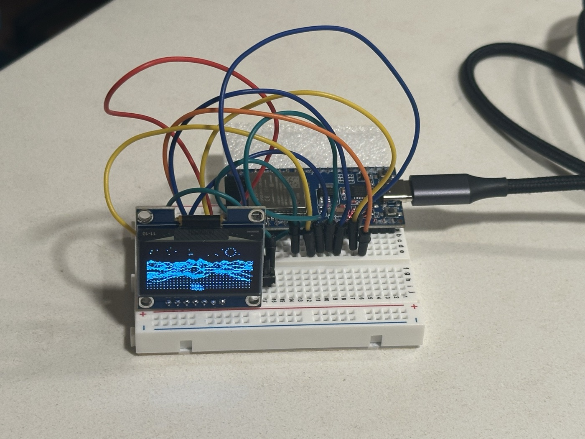
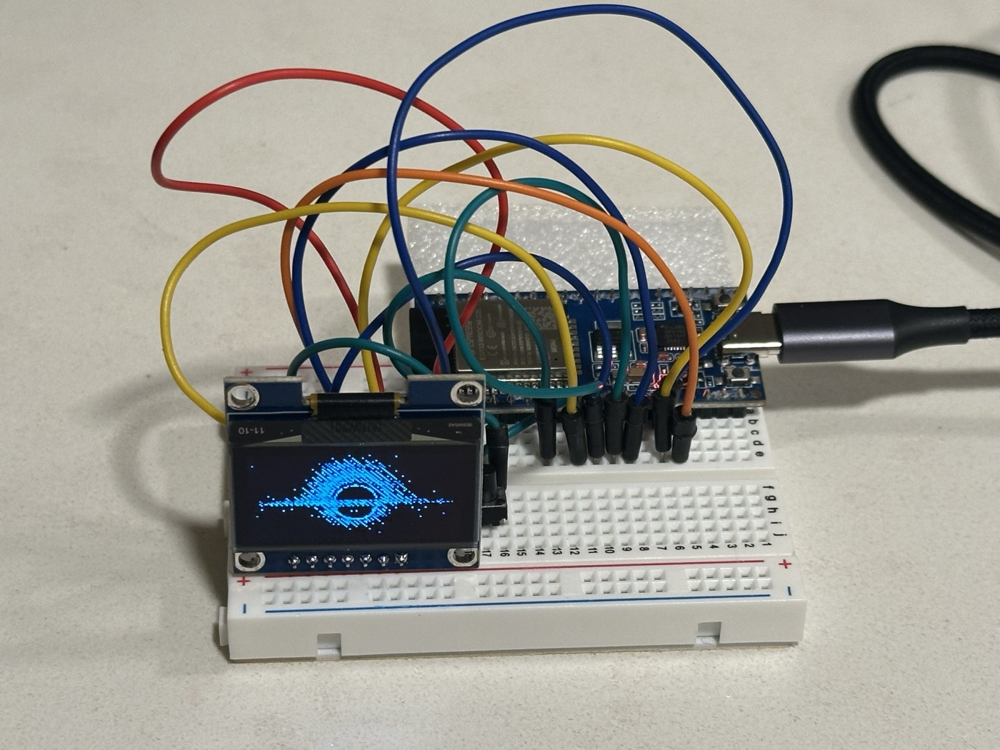
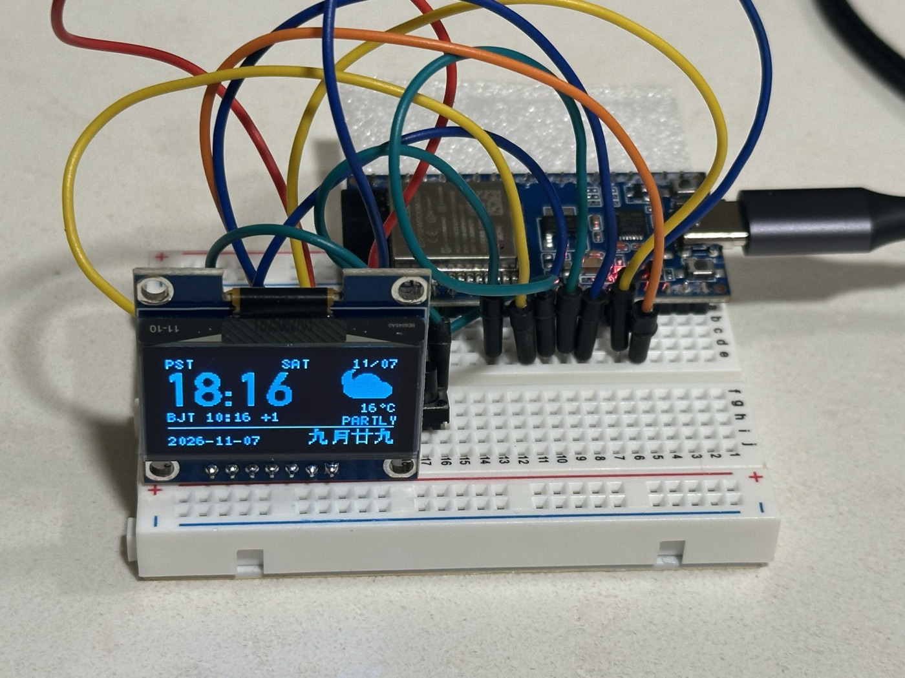
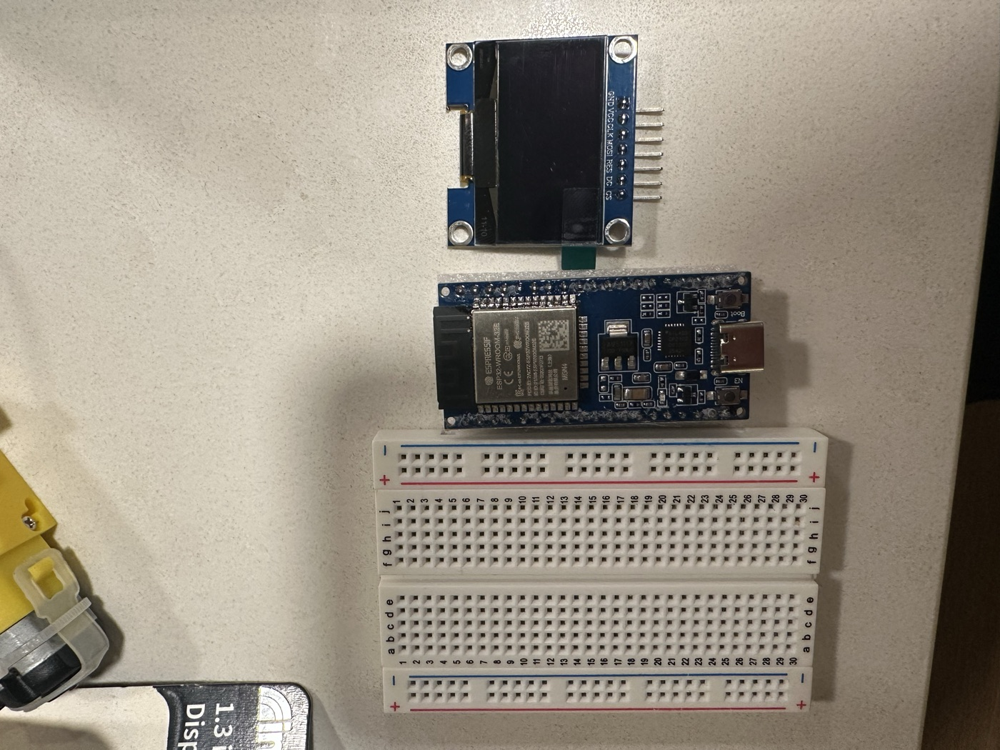
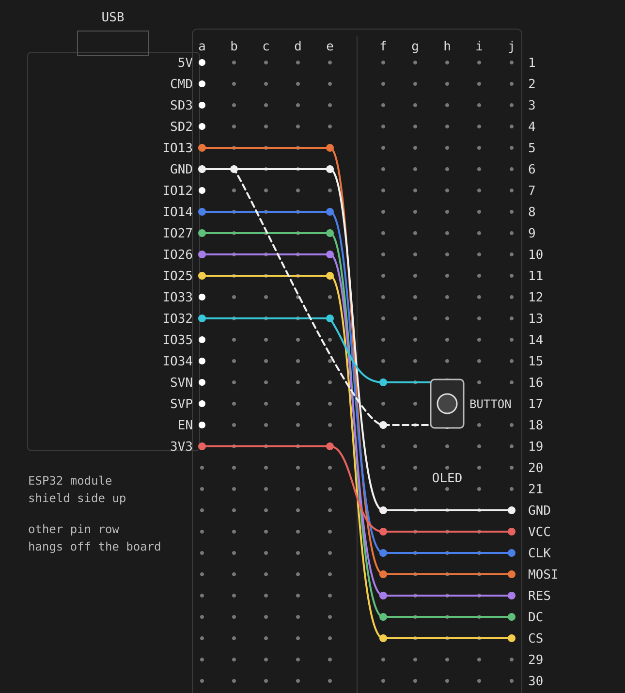

# DeskPet ESP32 · An Ocean and a Universe on a 1.3" Screen

**One ESP32, one tiny 128×64 OLED, one button.** Tap it and a storm rolls across a 3D night sea while a whale breaches under a moon that matches tonight's real sky. Double-tap and the camera sweeps past the Moon, Earth and Saturn, all the way into a black hole.

- 🌊 **An ocean you can stir up**: a real perspective sea that keeps churning. Tap to throw a huge wave from a random direction, with crests breaking into foam and spray.
- 🐋 **Whales**: they spout, raise their flukes, or launch their whole body out of the water. When they crash back down, the entire screen shakes.
- 🌕 **A moon that follows reality**: the phase is computed from the real date, so whatever moon is outside your window is the moon on the screen, with moonlight glittering across the waves.
- 🕳️ **A universe with a black hole**: a 3D camera tour from the Moon → Earth → Mars → Saturn → the Solar System → the Milky Way → a black hole. Gravitational lensing bends the starlight and the accretion disk spirals inward. A passing UFO gets pulled in if it flies too close.
- 🎨 **Grayscale on a black-and-white screen**: the monochrome OLED shows gray levels by flipping sub-frames fast. One CPU core renders, the other keeps the screen fed.
- 👀 **And an everyday side**: blinking robot eyes with expressions, plus an info screen with the clock, weather and the Chinese lunar calendar.

| Night ocean | Space tour |
|---|---|
|  |  |

> The GIFs are rendered frame by frame on a PC from the same `Ocean.cpp` / `Space.cpp` that run on the board. On the real OLED, the space screen's gray levels come from rapidly alternating sub-frames; in the GIF they are drawn as gray.

**On the real hardware:**

| Night ocean | Black hole | Overview |
|---|---|---|
|  |  |  |

## Screens

1. **Overview**: big DIN-style Pacific time clock (PST/PDT switches automatically), Beijing time, weekday and date, live weather from Open-Meteo with locally drawn icons, and the Gregorian plus Chinese lunar date (leap months included, 2000–2099).
2. **Robot eyes**: eyes that blink and glance around. Tap to change expression: normal, happy, angry, sleepy, surprised, sad. The eye engine is [fonzu/RobotEye](https://github.com/fonzu/RobotEye) (MIT); see Credits.
3. **Night ocean**: a ray-marched perspective heightfield sea, rolling swells out to the horizon, whitecaps and spray, stars and shooting stars, and a moon showing the real phase reflected on the water.
   - Tap: a big wave from the left, right, front or back. Each wave raises the chance of a whale.
   - Long press: summon a whale right away (breach → spout → fluke). Whales also show up on their own every 1–3 minutes.
4. **Space tour** (fake grayscale): Moon → Earth → Mars → Saturn → Solar System → Milky Way → Black hole → Moon, flown along 3D camera arcs.
   - Tap: fly to the next stop.
   - Long press: switch between 3-level gray (default), 4-level gray and pure black and white.
   - A UFO flies by now and then, and at the black hole it gets sucked in.

## Button

| Action | Effect |
|---|---|
| Double-tap (two presses < 350 ms apart) | Next screen: Overview → Eyes → Ocean → Space → Overview |
| Tap | Interact with the current screen (see above) |
| Long press (~0.8 s) | Ocean: summon a whale · Space: change gray mode |

For testing, send `s` / `d` / `l` in the serial monitor (115200 baud) to simulate a tap, double-tap or long press.

## Bill of Materials

| Part | Notes |
|---|---|
| ESP32-WROOM-32E dev board | Any "ESP32 Dev Module" board works; the one pictured has USB-C |
| 1.3" SH1106 128×64 OLED | 7-pin **SPI** version (GND VCC CLK MOSI RES DC CS), not the 4-pin I²C one |
| Tactile push button | Two-pin (a four-pin one works too, using two diagonal legs) |
| Half-size breadboard | 400 points, 30 rows |
| Male-to-male jumper wires | 9 (7 for the display, 2 for the button) |
| USB-C data cable | For power and uploading |



## Wiring



The ESP32's GPIO pin row sits in column **a** (rows 1–19), with the module's metal shield facing up; its other pin row hangs off the edge of the breadboard. The OLED's pins go into column **j**, rows 22–28.

| OLED | ESP32 |
|---|---|
| GND | GND |
| VCC | 3V3 |
| CLK / SCK | GPIO14 |
| MOSI | GPIO13 |
| RES / RST | GPIO26 |
| DC | GPIO27 |
| CS | GPIO25 |

| Button | ESP32 | Breadboard |
|---|---|---|
| Leg 1 | GPIO32 | leg in h16, jumper f16 → e13 |
| Leg 2 | GND | leg in h18, jumper f18 → b6 |

The internal pull-up is enabled, so the button needs no resistor.

GPIO numbers are the IO14, IO13, … labels printed on the board, not pin positions. The display is rotated 180° in code. If yours ends up upside down, change `U8G2_R2` to `U8G2_R0`.

## Build and Upload

1. Install the [Arduino IDE](https://www.arduino.cc/en/software), then install **esp32 by Espressif** in the Boards Manager (tested with 3.3.12).
2. Install **U8g2** in the Library Manager (tested with 2.36.19). The networking and JSON libraries come with the ESP32 core.
3. Open `DeskPet_ESP32/DeskPet_ESP32.ino`.
4. Copy `Config.example.h` to `Config.h` and fill in your **2.4 GHz** Wi-Fi name and password, plus the latitude and longitude for the weather. `Config.h` is in `.gitignore`, so it is never committed.
5. Select **ESP32 Dev Module** and your serial port, then upload. The sketch uses about 93% of the default partition. If you add features, pick Tools → Partition Scheme → Huge APP.
6. The screen shows SYNCING TIME until Wi-Fi connects and the clock is set, then the overview appears.

If the upload hangs on "Connecting…", hold the BOOT button on the board until writing starts.

## Troubleshooting

At boot the serial monitor (115200 baud) prints Wi-Fi diagnostics:

- `yours NOT found`: the network name is wrong, or the router only broadcasts on 5 GHz.
- `reason 15: 4-way handshake timeout`: usually a wrong password. The log also prints a `Password fingerprint` (the first 8 hex digits of the password's SHA-256, which does not reveal it). Compare it on your computer:
  ```bash
  printf '%s' 'your-password' | shasum -a 256 | cut -c1-8
  ```
- After repeated handshake failures, the sketch cycles through fallbacks automatically: lock to the strongest access point, lower TX power, disable PMF, 802.11b/g only.
- Blank screen: set `OLED_HW_SPI` to `0` in `DeskPet_ESP32.ino` to fall back to software SPI.
- Gray levels flicker too much: long-press for pure black and white, or set `OLED_FAST_OSC` to `0`.

## How It Works

- **Ocean**: a front-to-back column ray march through a heightfield made of several directional, sharpened sine waves, distant swells and big-wave fronts. Lambert lighting plus moon glints, Bayer dithering, and particles for spray and foam. Whales are smoothed polygons, scanline-filled and occluded by the waves. Each CPU core draws half the screen.
- **Space**: ray-sphere intersection with a depth buffer, ray-plane intersection for Saturn's rings and the galactic disk, and screen-space gravitational lensing for the black hole. Frames render on the second core while the main core streams gray sub-frames (hardware SPI at 8 MHz plus the SH1106's fastest internal oscillator).
- **Only the current screen runs**: the space renderer's task and its ~48 KB of buffers are created when you enter the screen and freed when you leave. Holding that memory from boot made the Wi-Fi handshake fail.
- **Button**: sampled every 5 ms by its own task, so presses are never missed, however busy the frame is.

## Credits and License

- **Robot eyes / expressions**: `robot_eye.cpp`, `robot_eye.hpp` and `RobotEye.h` come from [fonzu/RobotEye](https://github.com/fonzu/RobotEye). Copyright stays with the original author; the files keep their MIT license in [`DeskPet_ESP32/LICENSE-RobotEye-MIT.txt`](DeskPet_ESP32/LICENSE-RobotEye-MIT.txt). The expressions are not original to this project.
- **Lunar calendar data**: `LunarData.h` is generated from the YEAR_INFOS table of [python-lunardate](https://github.com/lidaobing/python-lunardate) (GPL v2).
- **Weather data**: [Open-Meteo](https://open-meteo.com/) (CC BY 4.0). No API key is needed for personal, non-commercial use.
- **Display library**: [U8g2](https://github.com/olikraus/u8g2) (BSD 2-clause). Install it separately; it is not included here.
- Full source notes: [`DeskPet_ESP32/SOURCES.txt`](DeskPet_ESP32/SOURCES.txt).

The rest of the code (overview, ocean, space, …) is released under the **GNU GPL v2** to stay compatible with the lunar data; see [LICENSE](LICENSE). The RobotEye files keep their original MIT license.
