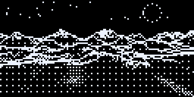
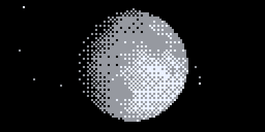
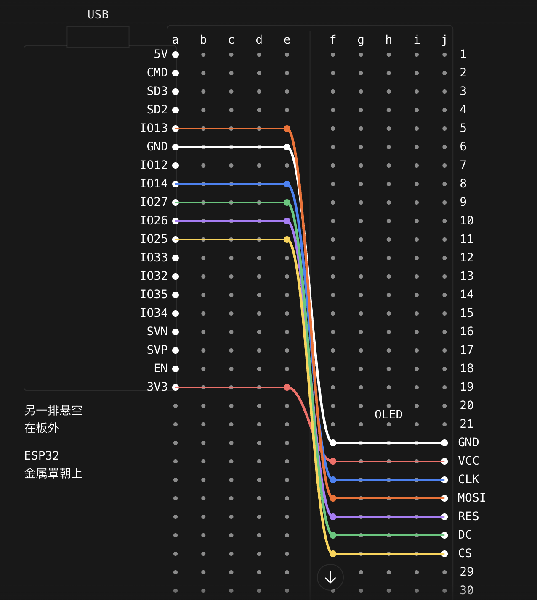

# DeskPet ESP32

一个放在桌上的 ESP32 小摆件：1.3 寸 128×64 OLED + 一个按钮，四个界面——信息总览、机器人眼睛、3D 夜海、太空巡游。

A tiny ESP32 desk companion with a 1.3" 128×64 OLED and one button: an info dashboard, robot eyes, a 3D night ocean and a space tour.

| 3D 夜海 Night ocean | 太空巡游 Space tour |
|---|---|
|  |  |

> GIF 由同一份 `Ocean.cpp` / `Space.cpp` 在电脑上逐帧渲染得到；太空界面在实物屏上是用快速切换子帧做出的假灰度，GIF 里直接画成灰色。
> The GIFs are rendered on a PC from the same source files. On the real OLED the space screen's gray levels come from rapidly alternating sub-frames.

## 四个界面 Screens

1. **信息总览 Overview**：太平洋时间（PST/PDT 自动切换）大号 DIN 时钟、北京时间、星期和日期、实时天气（Open-Meteo，本地绘制天气图标）、公历和中文农历（含闰月，2000–2099）。
2. **机器人眼睛 Robot eyes**：会眨眼、看来看去的眼睛，单击换表情（正常、开心、生气、困、惊讶、难过）。眼睛引擎来自 [fonzu/RobotEye](https://github.com/fonzu/RobotEye)（MIT），见下方致谢。
3. **3D 夜海 Night ocean**：透视高度场光线步进的海面，远处海平线一排排涌浪，浪尖白沫和浪花，星空、流星，月亮按真实日期显示月相并在海面反光。
   - 单击：从左、右、前、后随机方向掀起一道大浪；造浪后鲸鱼出现概率提高。
   - 长按：马上叫鲸鱼（鲸跃 → 喷水 → 翘尾）；鲸鱼也会每 1–3 分钟随机出现，鲸跃落水时屏幕震动。
4. **太空巡游 Space tour**（假灰度）：月球 → 地球 → 火星 → 土星 → 太阳系 → 银河系 → 黑洞 → 月球，镜头沿 3D 弧线飞行。
   - 单击：飞到下一站。
   - 长按：切换 3 级灰（默认）/ 4 级灰 / 纯黑白。
   - 偶尔有 UFO 飞过，在黑洞那一站会被吸进去。

## 按钮 Button

| 操作 | 作用 |
|---|---|
| 双击（两下间隔 < 350 ms） | 切换界面：总览 → 眼睛 → 海洋 → 太空 → 总览 |
| 单击 | 当前界面互动（见上） |
| 长按约 0.8 s | 海洋叫鲸鱼 / 太空切换灰度 |

串口监视器（115200）里发送 `s` / `d` / `l` 等于单击 / 双击 / 长按，方便调试。

## 硬件 Hardware

- ESP32 WROOM 开发板（ESP32 Dev Module）
- 1.3 寸 SH1106 128×64 OLED，7 针 SPI 版（GND VCC CLK MOSI RES DC CS）
- 一个两脚轻触按钮
- 面包板和杜邦线

## 接线 Wiring



| OLED | ESP32 |
|---|---|
| GND | GND |
| VCC | 3V3 |
| CLK / SCK | GPIO14 |
| MOSI | GPIO13 |
| RES / RST | GPIO26 |
| DC | GPIO27 |
| CS | GPIO25 |

按钮：一脚接 **GPIO32**，另一脚接 **GND**（程序开启内部上拉，不需要电阻）。

GPIO 编号是板子丝印上的 IO14、IO13 等，不是数第几个针。屏幕在程序里旋转了 180°，如果你的屏装反了，把 `U8G2_R2` 改成 `U8G2_R0`。

## 编译上传 Build

1. 安装 [Arduino IDE](https://www.arduino.cc/en/software)，在开发板管理器安装 **esp32 by Espressif**（已用 3.3.12 测试）。
2. 库管理器安装 **U8g2**（已用 2.36.19 测试）。网络和 JSON 库随 ESP32 开发板包自带。
3. 打开 `DeskPet_ESP32/DeskPet_ESP32.ino`。
4. 把 `Config.example.h` 复制一份改名为 `Config.h`，填入你的 **2.4 GHz** Wi-Fi 名称和密码，以及天气位置的经纬度。`Config.h` 已在 `.gitignore` 里，不会被提交。
5. 开发板选 **ESP32 Dev Module**，选择串口，上传。程序约占默认分区的 93%，以后加功能可在 工具 → Partition Scheme 选 Huge APP。
6. 开机显示 SYNCING TIME，联网校时后进入信息总览。

上传一直 Connecting 时，按住板上的 BOOT，开始写入后松开。

## 常见问题 Troubleshooting

开机时串口（115200）会打印 Wi-Fi 诊断：

- `yours NOT found`：名称不对，或者路由器只开了 5 GHz。
- `reason 15: 4-way handshake timeout`：通常是密码不对。串口还会打印 `Password fingerprint`（密码 SHA-256 的前 8 位，不泄露密码），可以在电脑上对照：
  ```bash
  printf '%s' '你的密码' | shasum -a 256 | cut -c1-8
  ```
- 握手连续失败时程序会自动轮流尝试：锁定最强热点、降低发射功率、关闭 PMF、只用 802.11b/g。
- 屏幕不亮：把 `DeskPet_ESP32.ino` 里的 `OLED_HW_SPI` 改成 `0`，改用软件 SPI。
- 太空界面灰度闪得难受：长按切到纯黑白，或把 `OLED_FAST_OSC` 改成 `0`。

## 实现要点 How it works

- 海洋：逐列从近到远光线步进的高度场（多组定向尖峰正弦波 + 远处涌浪 + 大浪波前），Lambert 光照 + 月光高光，Bayer 抖动，粒子做浪花和白沫；鲸鱼是平滑多边形扫描线填充并与海面做遮挡。两个 CPU 核心各算半屏。
- 太空：光线-球求交 + 深度缓冲，土星环和银河盘用光线-平面，黑洞用屏幕空间引力透镜；在第二个核心上渲染，主核心连续推送灰度子帧（硬件 SPI 8 MHz + SH1106 最快内部振荡器）。
- 只运行当前界面：太空界面的渲染任务和约 48 KB 绘图内存只在进入时创建、离开就释放（开机就占用会让 Wi-Fi 握手失败）。
- 按钮由独立任务每 5 ms 采样，画面再忙也不会漏按。

## 致谢与许可 Credits & License

- **机器人眼睛 / 表情**：`robot_eye.cpp`、`robot_eye.hpp`、`RobotEye.h` 来自 [fonzu/RobotEye](https://github.com/fonzu/RobotEye)，版权归原作者，按 MIT 许可保留在 [`DeskPet_ESP32/LICENSE-RobotEye-MIT.txt`](DeskPet_ESP32/LICENSE-RobotEye-MIT.txt)。表情不是本项目原创。
- **农历数据**：`LunarData.h` 由 [python-lunardate](https://github.com/lidaobing/python-lunardate)（GPL v2）的 YEAR_INFOS 数据生成。
- **天气数据**：[Open-Meteo](https://open-meteo.com/)（CC BY 4.0），个人非商业使用无需 API key。
- **显示库**：[U8g2](https://github.com/olikraus/u8g2)（BSD 2-clause，需自行安装，未包含在本仓库）。
- 详细来源见 [`DeskPet_ESP32/SOURCES.txt`](DeskPet_ESP32/SOURCES.txt)。

本项目其余代码（信息总览、海洋、太空等）为兼容农历数据的 GPL v2，以 **GNU GPL v2** 发布，见 [LICENSE](LICENSE)；RobotEye 文件保留其原始 MIT 许可。
